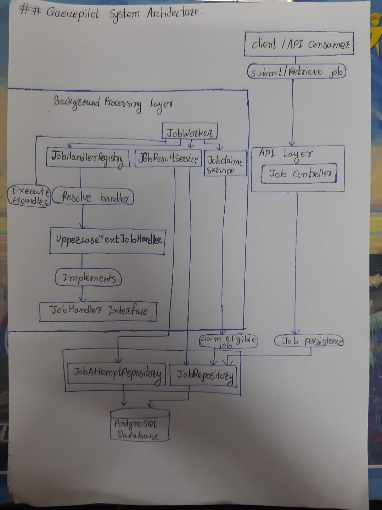
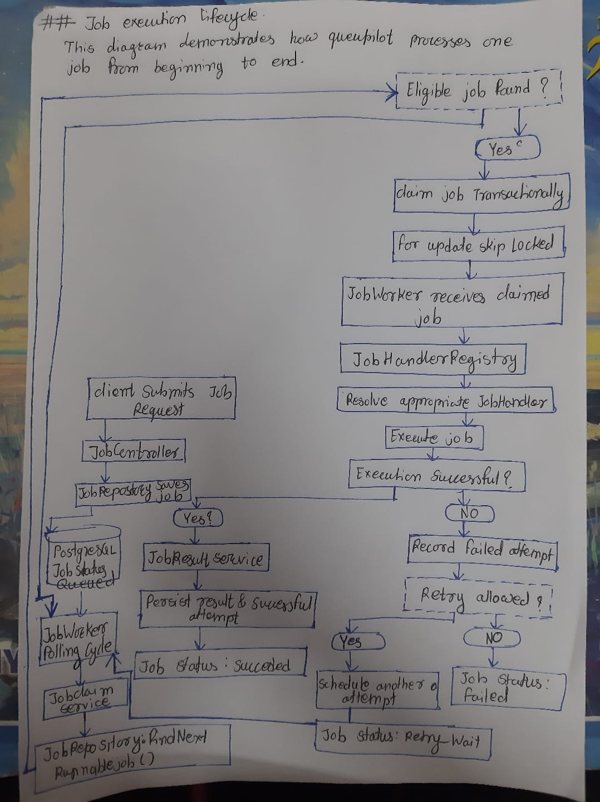

# QueuePilot — AI-Enhanced Job Queue Management System

QueuePilot is a full-stack job orchestration platform for submitting background tasks, processing them asynchronously, and tracking job status, results, and execution history.

**Stack:** React · TypeScript · Vite · Java 21 · Spring Boot · Spring Data JPA · PostgreSQL · Flyway · Maven

**Project status:** Core backend job processing is implemented and being refined. The React dashboard and end-to-end integration are in progress. AWS deployment and AI features are planned.

## Overview

QueuePilot separates job submission from execution. Jobs are persisted in PostgreSQL and processed by background workers. The planned product extends this core with a web dashboard, AWS hosting, and AI-assisted job intelligence.

## Current Implementation

- REST APIs for job submission and retrieval.
- PostgreSQL persistence for jobs, execution attempts, statuses, schedules, and results.
- Background worker and handler registry, with an uppercase-text handler as the first example job type.
- Transactional job claiming with PostgreSQL `FOR UPDATE SKIP LOCKED`, allowing concurrent workers to skip already-locked jobs and claim other eligible jobs.
- Execution-attempt tracking and retry-aware failure handling.
- Flyway database migrations and Spring Boot/JUnit tests.

## System Architecture



## Job Execution Lifecycle



## Planned Roadmap

### Full-Stack Dashboard

- Complete the React dashboard and connect it to the backend APIs.
- Provide a user interface to submit jobs and view their status, results, and execution history.

### AWS Deployment

- Host the React frontend using **Amazon S3** and **CloudFront**.
- Deploy the Spring Boot API on **Amazon EC2**.
- Use **Amazon RDS for PostgreSQL** for managed database hosting.
- Apply **IAM** least-privilege access, private networking, HTTPS, and protected configuration with **AWS Secrets Manager** or environment-based secrets.
- Use **Amazon CloudWatch** for application logs and infrastructure monitoring.

### AI-Assisted Job Intelligence

- Add **LLM-based job classification**: analyse a natural-language job description and suggest a task category, with backend validation before the category is accepted.
- Explore **AI-assisted failure analysis** using job-attempt history and available diagnostic information to explain failures and surface useful job insights.

### Reliability and Scalability

- Evaluate **Amazon SQS** or **Redis** for queueing and coordination needs.
- Explore dead-letter handling, idempotent execution, worker scaling, structured logging, and performance testing under concurrent workloads.

> Roadmap items describe the intended direction of the project; they are not presented as completed features.

## Technology Stack

| Area | Technologies |
|---|---|
| Frontend | React, TypeScript, Vite |
| Backend | Java 21, Spring Boot, Spring Data JPA |
| Database | PostgreSQL, Flyway |
| Build and testing | Maven, JUnit, Spring Boot Test |
| Cloud (planned) | AWS S3, CloudFront, EC2, RDS, IAM, Secrets Manager, CloudWatch |
| AI (planned) | LLM API / language-model integration |

## Run the Backend Locally

**Prerequisites:** JDK 21, Maven, PostgreSQL, and Git.

1. **Clone the repository and open the backend directory:**

   git clone https://github.com/magarsanchita1110697-arch/QueuePilot.git
   cd QueuePilot/backend/queuepilot-backend

2. **Create the PostgreSQL role and database.** Run these SQL statements in a PostgreSQL session (for example, through `psql` as a database administrator or pgAdmin). Replace `your_password` with your own password:

 
   CREATE ROLE queuepilot_user WITH LOGIN PASSWORD 'your_password';
   CREATE DATABASE queuepilot OWNER queuepilot_user;
   

3. **Set the database password in Ubuntu/WSL.** Run this in the same terminal session you will use to start the backend:

   
   export QUEUEPILOT_DB_PASSWORD='your_password'
   

4. **Run the tests:**

   mvn clean test
  

5. **Start the backend:**

   mvn spring-boot:run


## Repository Structure

```text
QueuePilot/
├── backend/    # Spring Boot backend
├── frontend/   # React and Vite dashboard
├── docs/       # Architecture and lifecycle diagrams
└── README.md
```

## Goals

Build a maintainable job orchestration platform that demonstrates backend engineering, full-stack development, cloud deployment, reliable asynchronous processing, and practical AI integration.
